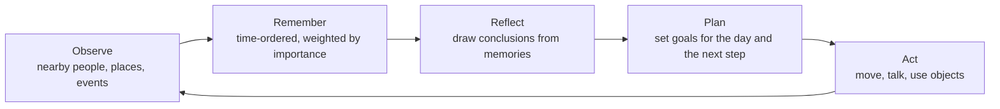
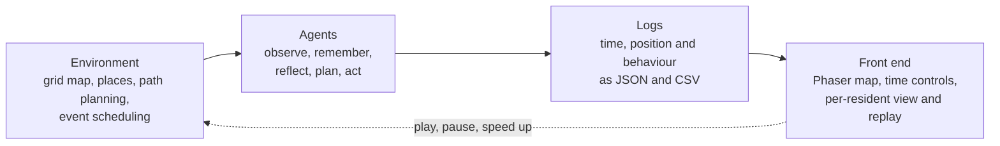

# AI Town

**English** | [中文](README.zh-CN.md)

A small virtual town for teaching how AI agents behave. Simulated residents go about their day on a 2D map, and a teacher can replay what each one noticed, remembered and decided. I adapted it from an open-source research project as a course project at Sanda University, Shanghai (October to December 2025).

This repository is a showcase: screenshots, a short screen capture, a poster and this write-up. It contains no source code. [Third-party work](#third-party-work) says what the system is built on and which parts are mine.

## Contents

- [At a glance](#at-a-glance)
- [Why I built it](#why-i-built-it)
- [Who it is for](#who-it-is-for)
- [How a resident thinks](#how-a-resident-thinks)
- [How the system is put together](#how-the-system-is-put-together)
- [Screens](#screens)
- [In the classroom](#in-the-classroom)
- [Test runs](#test-runs)
- [What is not finished](#what-is-not-finished)
- [Third-party work](#third-party-work)
- [Tools](#tools)
- [Poster](#poster)
- [Rights and contact](#rights-and-contact)

## At a glance

| | |
|---|---|
| What it is | A multi-agent simulation used as a classroom demonstration. Residents of a virtual town observe, remember, reflect, plan and act |
| Built on | The open-source Generative Agents research code, through a Chinese-language adaptation of it |
| My part | Adapting it for teaching: reworking the code so it can be read in class, a one-command launcher, the classroom use, the scale tests and the course report |
| Stack | Python 3.9, Django 2.2, a Phaser 2D map in the browser, JSON and CSV files for state and logs |
| Scale tested | 10, 50 and 100 agents, for up to 2,000 steps |
| Context | Course project in Software Engineering, Sanda University, 2025 |
| Status | Finished course project. The interface is in Chinese |

## Why I built it

Courses on AI lean towards algorithms and theory, with little that students can watch. It is hard to see from a diagram how one agent's behaviour comes about, or how a group of agents affect each other. A town that runs in front of the class makes observing, remembering, reflecting and planning visible, one step at a time.

## Who it is for

| User | What they need | What the system gives them |
|---|---|---|
| Teacher | A live example for a lecture on agents | A town that can be played, paused and sped up, and a replay of any single resident |
| Student | To see why an agent did something | The map, each resident's current action, and a page with its memory and plan |

## How a resident thinks

Each resident goes through the same five stages. What it observes is stored with a time and an importance weight. Reflection turns groups of memories into general conclusions. Planning uses both to decide what to do next, and the action changes what the other residents observe.

## How the system is put together

| Layer | What it does |
|---|---|
| Environment | A 2D grid map with dormitories, shops, a park and a café. It handles path planning and schedules events |
| Agents | Run the five-stage cycle for every resident |
| Logs | Record each resident's time, position and behaviour at every step, in JSON and CSV |
| Front end | Draws the map and the residents in the browser and gives the controls |

The data is kept in four groups: environment, persona, logs and storage. Each is saved as JSON and managed separately, so a new event type or a new resident attribute can be added without touching the others.

## Screens

| | |
|---|---|
|  |  |
| The town: homes, shared buildings and open ground on a grid map | A close view. Residents walk between rooms and use the objects in them |
|  |  |
| A bubble above each resident shows its name and what it is doing | The simulator page: residents along the top, the map in the middle, the selected resident's status below |
|  |  |
| Time controls: continue, pause and speed up, with the simulated date and time | One resident's page: basic information, settings, personality and the plan for the day |

The launcher starts the web server, opens the simulator and replay pages, and then starts the simulation.

## In the classroom

1. **Start.** One command starts everything and opens the pages.
2. **Run.** The residents begin their day. The teacher can pause at any point or speed up the quiet parts.
3. **Pick a resident.** Clicking a resident opens its state: what it is doing, what it remembers and what it has planned.
4. **Replay.** A finished run is replayed from its logs, as a whole or for a single resident, and the teacher talks through why it acted as it did.
5. **Change the scene.** Social, shopping and gathering events give different situations to compare.

## Test runs

Figures as recorded in the course report. All runs were on one laptop (Intel i7-12700H, 16 GB of memory) with Python 3.9, Django 2.2 and Chrome.

| Agents | Steps | CPU use | Memory | Frame rate | Logs |
|---|---|---|---|---|---|
| 10 | 2,000 | 25% | 0.6 GB | 60 fps | Written normally |
| 50 | 2,000 | 45% | 1.2 GB | 58 fps | Written steadily |
| 100 | 2,000 | 70% | 1.8 GB | 52 fps | A slight delay, no errors |

The tests covered 10, 50 and 100 agents at 500, 1,000 and 2,000 steps. They checked stability and smoothness. They did not measure how good the agents' decisions were.

## What is not finished

- The town is 2D only.
- Behaviour still relies on rules.
- The course report includes no measurement of whether students learned more with it.
- The interface is in Chinese only.

## Third-party work

This project is an adaptation. It is not written from scratch.

- **Generative Agents.** The simulation framework, the agent architecture (perceive, memory, reflect, plan), the town map and character art, and the browser front end with replay come from the open-source code released with [Generative Agents: Interactive Simulacra of Human Behavior](https://arxiv.org/abs/2304.03442) (Park et al., 2023).
- **A Chinese-language adaptation of it.** I started from a community version that had already added a Chinese interface and support for local language models.

My own work:

- **Making the code readable in class.** I reworked 32 of the 185 source files in the simulation core and the front-end templates. Much of that was rewriting comments and docstrings in Chinese across the planning, memory, reflection, perception, execution and path-finding modules, and tidying the main simulation server.
- **A one-command launcher.** It checks the dependencies, starts the web server, opens the simulator and replay pages, and then starts the simulation.
- **The teaching side.** How the town is used in a lesson, the system diagrams, the scale tests above and the course report.

## Tools

Python 3.9, Django 2.2, Phaser, JSON and CSV files, Chrome, PyCharm.

## Poster

A one-page summary of the project, made in October 2026.

## Rights and contact

The town map and character art in the screenshots belong to the authors of the original project. The write-up, diagrams and poster are © 2025-2026 Yuxiang (Evan) Huang. Please ask before reusing them.

Contact: [LinkedIn](https://www.linkedin.com/in/evan-h-165976301/)
