# AI Town

**English** · [简体中文](README.zh-CN.md)

AI Town is a small virtual town for teaching how AI agents behave. Simulated residents go about their day on a 2D map in the browser. They move between places and react to events and to each other. A teacher can pause the town, speed it up and replay what each resident noticed, remembered and decided.

Each resident is an AI agent that runs the same cycle: observe, remember, reflect, plan and act. That cycle is what a class watches. Every step is logged, so a finished run can be played back and the class can ask why a resident acted as it did.

This is a course project in Software Engineering at Sanda University, Shanghai (October to December 2025). It is an adaptation, not a new agent design. The simulation framework, the agent architecture, the town map and the browser front end with replay come from the open-source Generative Agents research code, through a Chinese-language adaptation of it. My part was making it usable in a lesson.

This repository is a showcase only: a short screen capture, screenshots, a poster and this write-up. It contains no source code.

<table>
<tr>
<td><a href="media/preview.gif">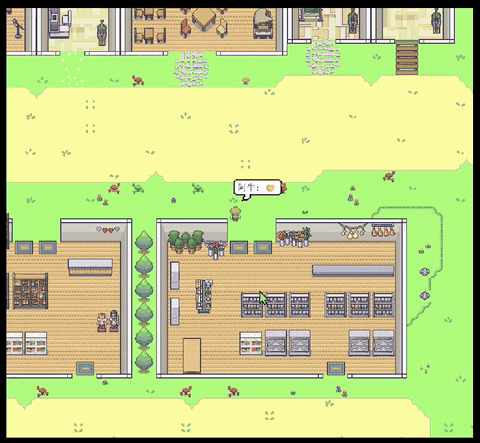</a></td>
<td><a href="media/poster.jpg">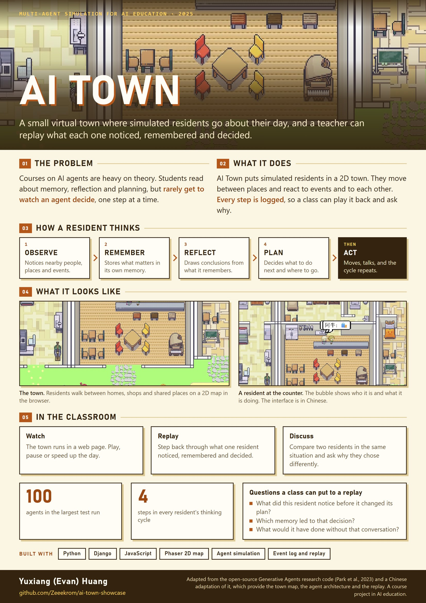</a></td>
</tr>
<tr>
<td align="center"><a href="media/preview.gif">Screen capture of the town running</a></td>
<td align="center"><a href="media/poster.jpg">Poster, October 2026</a></td>
</tr>
</table>

**Original research:** [Generative Agents: Interactive Simulacra of Human Behavior](https://arxiv.org/abs/2304.03442) (Park et al., 2023)
— the paper behind the [open-source code](https://github.com/joonspk-research/generative_agents) this project adapts.
That code is released under the Apache License 2.0.

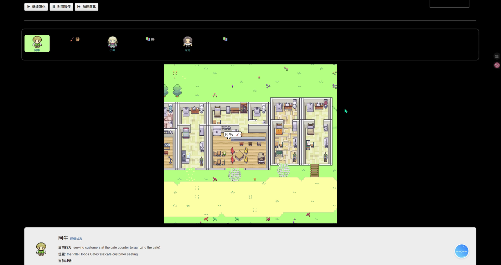

The simulator page. The time controls and the residents are along the top, the town map is in the middle, and the selected resident's current action and location are below. The interface is in Chinese. The town map and character art come from the original project.

## Contents

- [At a glance](#at-a-glance)
- [The problem](#the-problem)
- [Who it is for](#who-it-is-for)
- [One lesson, start to finish](#one-lesson-start-to-finish)
- [How a resident thinks](#how-a-resident-thinks)
- [The screens](#the-screens)
- [What works today](#what-works-today)
- [Design principles](#design-principles)
- [How it was built](#how-it-was-built)
- [Technology stack](#technology-stack)
- [Verification evidence](#verification-evidence)
- [What is not finished](#what-is-not-finished)
- [What the project showed](#what-the-project-showed)
- [Copyright and terms](#copyright-and-terms)

## At a glance

| | |
|---|---|
| What it is | A multi-agent simulation used as a classroom demonstration. Residents of a virtual town observe, remember, reflect, plan and act, and every step is logged for replay |
| Who it is for | Teachers who need a live example for a lecture on AI agents, and students who want to see why an agent did something |
| The problem | Courses on AI lean towards algorithms and theory. From a diagram it is hard to see how one agent's behaviour comes about, or how a group of agents affect each other |
| AI | Each resident is an agent built on the Generative Agents architecture. The Chinese-language version I started from had added support for local language models |
| Built on | The open-source Generative Agents research code (Apache License 2.0), through a Chinese-language adaptation of it |
| My part | Adapting it for teaching: reworking the code so it can be read in class, a one-command launcher, the classroom use, the scale tests and the course report |
| Stack | Python 3.9, Django 2.2, a Phaser 2D map in the browser, JSON and CSV files for state and logs |
| Evidence | Scale runs with 10, 50 and 100 agents for up to 2,000 steps on one laptop, recorded in the course report |
| Context | Course project in Software Engineering, Sanda University, Shanghai, October to December 2025 |
| Status | Finished course project. The interface is in Chinese |

## The problem

Courses on AI lean towards algorithms and theory, with little that students can watch. Students read about memory, reflection and planning, but rarely see an agent decide, one step at a time. A diagram does not answer the questions a class actually has:

- What did this resident notice before it changed its plan?
- Which memory led to that decision?
- What would it have done without that conversation?
- How do agents in a group affect each other?

AI Town runs a town in front of the class, so observing, remembering, reflecting and planning can be watched and then replayed.

## Who it is for

| User | What they need | What AI Town gives them |
|---|---|---|
| Teacher | A live example for a lecture on agents | A town that can be played, paused and sped up, and a replay of any single resident |
| Student | To see why an agent did something | The map, each resident's current action, and a page with its memory and plan |

These roles describe the classroom use set out in the course report. The report does not measure whether students learned more with it.

## One lesson, start to finish

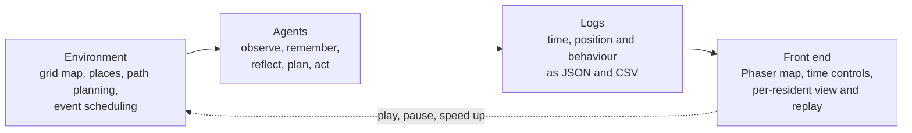

1. **Start.** One command checks the dependencies, starts the web server, opens the simulator and replay pages, and then starts the simulation.
2. **Run.** The residents begin their day. The teacher can pause at any point or speed up the quiet parts.
3. **Pick a resident.** Clicking a resident opens its state: what it is doing, what it remembers and what it has planned.
4. **Replay.** A finished run is replayed from its logs, as a whole or for a single resident, and the teacher talks through why it acted as it did.
5. **Change the scene.** Social, shopping and gathering events give different situations. Two residents in the same situation can be compared, and the class asks why they chose differently.

## How a resident thinks

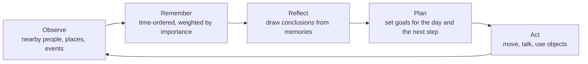

Each resident goes through the same five stages. What it observes is stored with a time and an importance weight. Reflection turns groups of memories into general conclusions. Planning uses both to decide what to do next, and the action changes what the other residents observe.

The cycle comes from the Generative Agents architecture. The course work is about showing it: the code for each stage was annotated in Chinese, and the screens let a class follow one resident through it.

## The screens

| | |
|---|---|
| 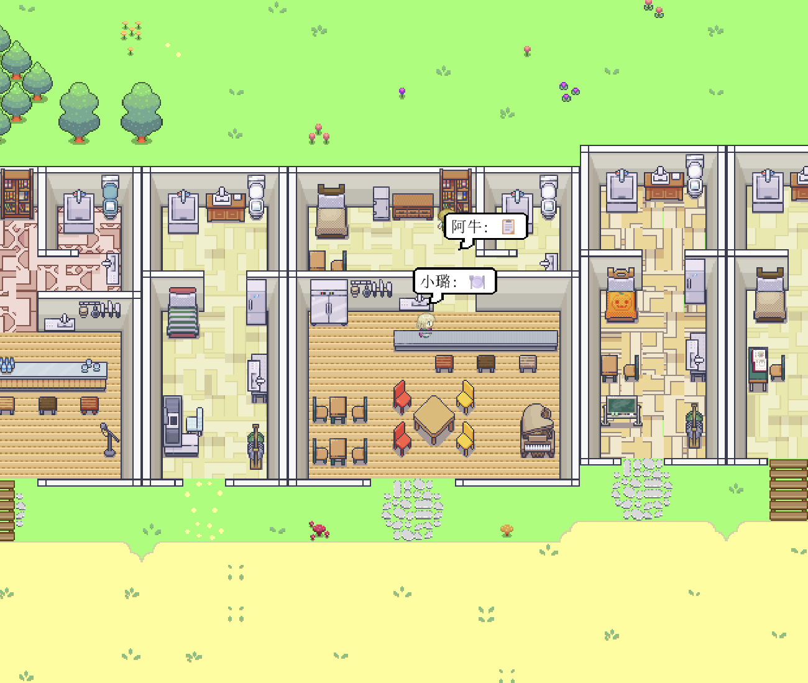 | 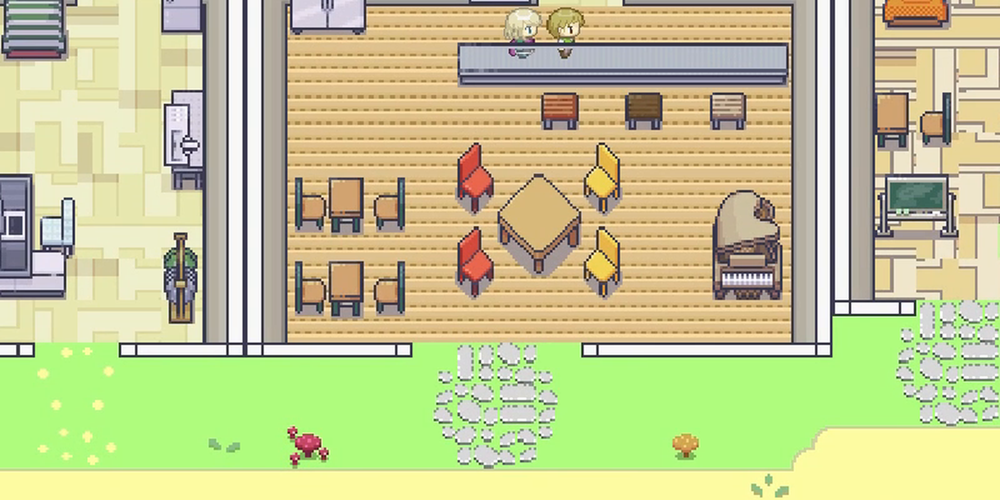 |
| **The town.** Homes, shared buildings and open ground on a grid map | **A close view.** Residents walk between rooms and use the objects in them |
| 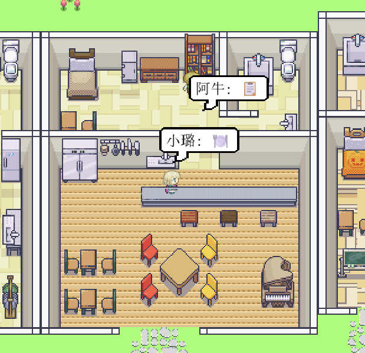 | 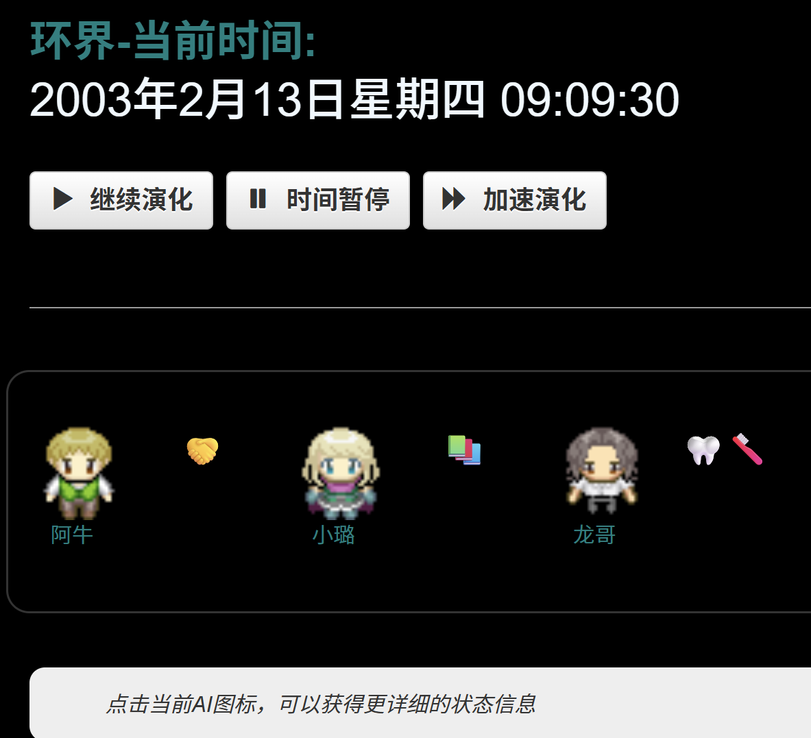 |
| **Speech bubbles.** A bubble above each resident shows its name and what it is doing | **Time controls.** Continue, pause and speed up, with the simulated date and time |
| 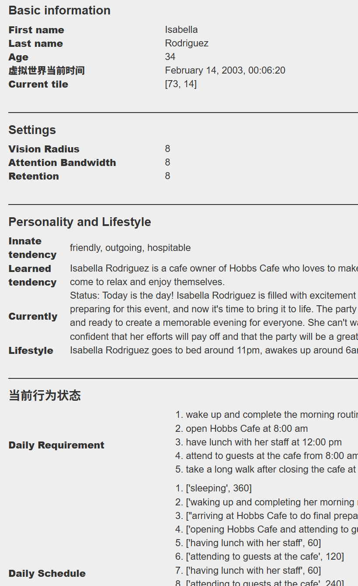 | 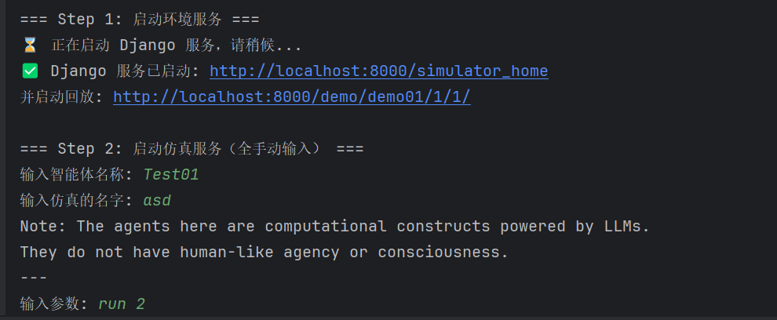 |
| **A resident's page.** Basic information, settings, personality and the plan for the day | **The launcher.** Starts the web server, opens the simulator and replay pages, then starts the simulation |

The simulator page is shown at the top of this page. The town map and character art come from the original project, which credits them to its artists.

## What works today

| Capability | What it does |
|---|---|
| Town map | A 2D grid map with dormitories, shops, a park and a café. Path planning moves residents between places |
| Resident cycle | Every resident observes, remembers, reflects, plans and acts. Memories are kept in time order with an importance weight |
| Events | The environment schedules events. Social, shopping and gathering events give different situations to compare |
| Step logs | Each resident's time, position and behaviour at every step, written as JSON and CSV |
| Browser map | Phaser draws the map and the residents. A bubble over each resident shows its name and current action |
| Time controls | Continue, pause and speed up, with the simulated date and time |
| Resident page | Basic information, settings, personality, memory and the plan for the day |
| Replay | A finished run is replayed from its logs, as a whole or for one resident |
| Separate data groups | Environment, persona, logs and storage are each saved as JSON and managed separately, so a new event type or resident attribute can be added without touching the others |
| Launcher | One command checks the dependencies, starts the web server, opens the simulator and replay pages, and starts the simulation |
| Code for class reading | Comments and docstrings in Chinese across the planning, memory, reflection, perception, execution and path-finding modules |
| Scale | Runs with up to 100 agents for 2,000 steps on one laptop |

The map, the agent cycle and the browser front end with replay come from the open-source code. The Chinese interface and local language-model support come from the community adaptation. The launcher and the reworked code were added for the course; see [How it was built](#how-it-was-built).

## Design principles

- **Make the thinking visible.** A class should watch observing, remembering, reflecting and planning happen one step at a time, not only read about it.
- **Log every step.** Each resident's time, position and behaviour is written at every step, so any run can be explained afterwards.
- **Follow one resident.** Any resident can be opened live or replayed on its own, so a class can follow one line of decisions.
- **The teacher controls time.** The town can be paused at any point, and the quiet parts can be sped up.
- **Keep the data groups apart.** A new event type or resident attribute should not mean changing everything else.
- **Code a class can read.** Comments and docstrings are in Chinese, the language of the course.
- **Claim only what was measured.** The scale tests checked stability and smoothness, and they are reported as that.

## How it was built

AI Town is an adaptation. It is not written from scratch.

**What it started from**

- **Generative Agents.** The simulation framework, the agent architecture (perceive, memory, reflect, plan), the town map and character art, and the browser front end with replay come from the open-source code released with [Generative Agents: Interactive Simulacra of Human Behavior](https://arxiv.org/abs/2304.03442) (Park et al., 2023).
- **A Chinese-language adaptation of it.** I started from a community version that had already added a Chinese interface and support for local language models.

**What I added for the course**

- **Code a class can read.** I reworked 32 of the 185 source files in the simulation core and the front-end templates. Much of that was rewriting comments and docstrings in Chinese across the planning, memory, reflection, perception, execution and path-finding modules, and tidying the main simulation server.
- **A one-command launcher.** It checks the dependencies, starts the web server, opens the simulator and replay pages, and then starts the simulation.
- **The teaching side.** How the town is used in a lesson, the system diagrams, the scale tests and the course report.

| Date | What happened |
|---|---|
| Oct to Dec 2025 | Course project in Software Engineering at Sanda University, Shanghai: the adaptation, the launcher, the scale tests and the course report |
| 11 Oct 2026 | This showcase published: the write-up, screenshots, a screen capture and the one-page poster made that month |

## Technology stack

- Python 3.9
- Django 2.2 for the web server
- Phaser (JavaScript) for the 2D map in the browser
- JSON and CSV files for state and logs
- Chrome to run the pages, PyCharm for development

| Layer | What it does |
|---|---|
| Environment | A 2D grid map with dormitories, shops, a park and a café. It handles path planning and schedules events |
| Agents | Run the five-stage cycle for every resident |
| Logs | Record each resident's time, position and behaviour at every step, in JSON and CSV |
| Front end | Draws the map and the residents in the browser and gives the controls |

## Verification evidence

The documented tests are the scale runs recorded in the course report. All runs were on one laptop (Intel i7-12700H, 16 GB of memory) with Python 3.9, Django 2.2 and Chrome.

| Agents | Steps | CPU use | Memory | Frame rate | Logs |
|---|---|---|---|---|---|
| 10 | 2,000 | 25% | 0.6 GB | 60 fps | Written normally |
| 50 | 2,000 | 45% | 1.2 GB | 58 fps | Written steadily |
| 100 | 2,000 | 70% | 1.8 GB | 52 fps | A slight delay, no errors |

The tests covered 10, 50 and 100 agents at 500, 1,000 and 2,000 steps; the table shows the 2,000-step runs. They checked stability and smoothness. They did not measure how good the agents' decisions were.

## What is not finished

- The town is 2D only.
- Behaviour still relies on rules.
- The course report includes no measurement of whether students learned more with it.
- The interface is in Chinese only.
- The scale tests ran on one laptop and say nothing about the quality of the agents' decisions.

## What the project showed

- Logging every step is what makes a run explainable afterwards. The replay works because the logs are there.
- Making research code teachable was mostly reading work. Much of the change was comments and docstrings, not new features.
- On one laptop the town stayed smooth up to 100 agents (52 fps at 70% CPU). Smooth running is not the same as good decisions, and that was not measured.
- Naming which parts are borrowed makes clear what the course work actually was.

## Copyright and terms

© 2025-2026 AI Town. All rights reserved; see [LICENSE](LICENSE). Without written permission, nothing in this repository may be copied, republished or adapted, and the project's code and design may not be rebuilt, whether by hand, with automated tools or with AI cloning tools. The code may not be reverse engineered except where the law allows, and the content may not be scraped, bulk-downloaded or used to train or evaluate AI models. Uses the law already allows, such as fair dealing for review or news reporting, are not affected. Sharing links is welcome. The open-source parts keep their own licence: the Generative Agents code is under the Apache License 2.0, and the town map and character art seen in the screenshots, screen capture and poster keep their creators' rights. To ask for permission, contact me on [LinkedIn](https://www.linkedin.com/in/evan-h-165976301/).
