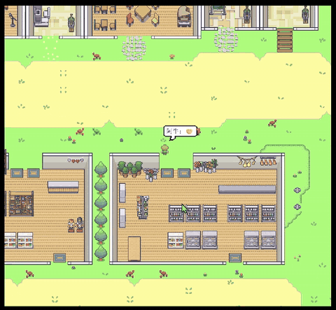
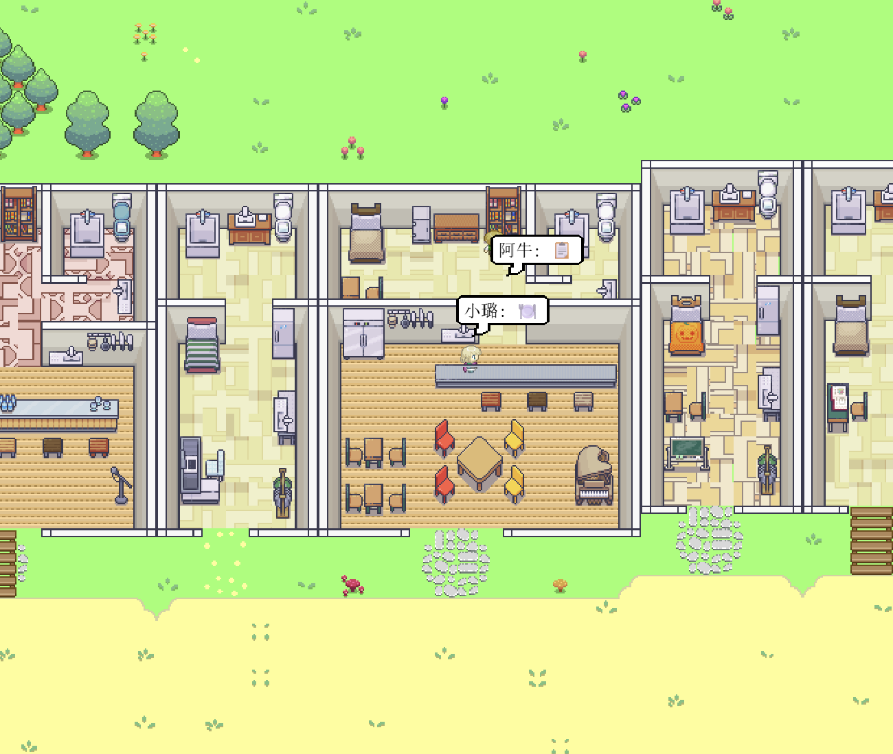
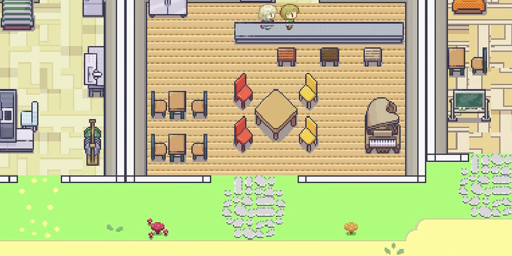
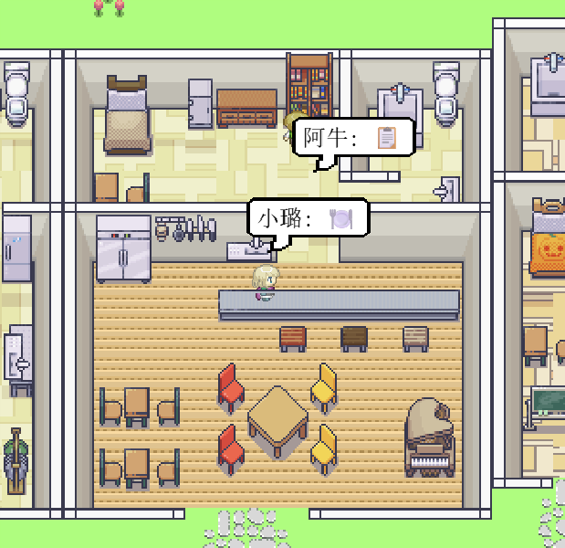
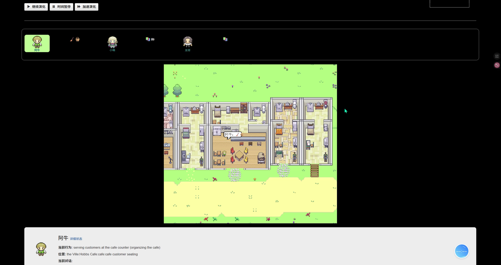
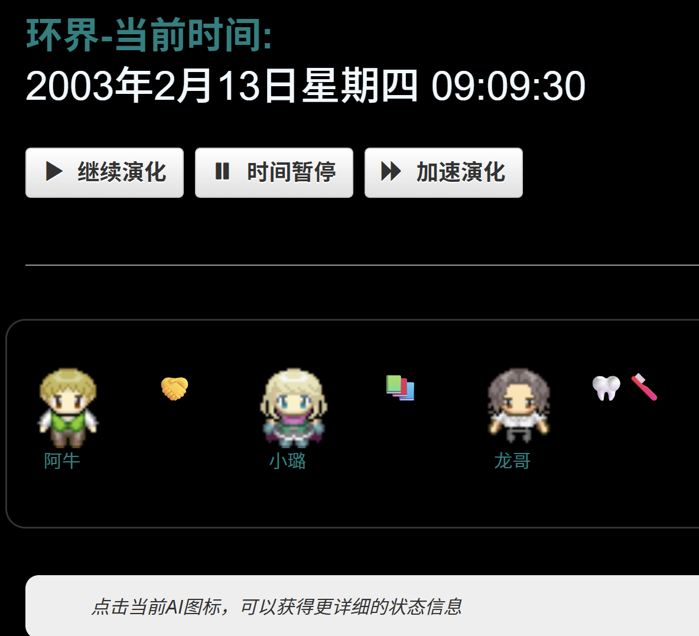
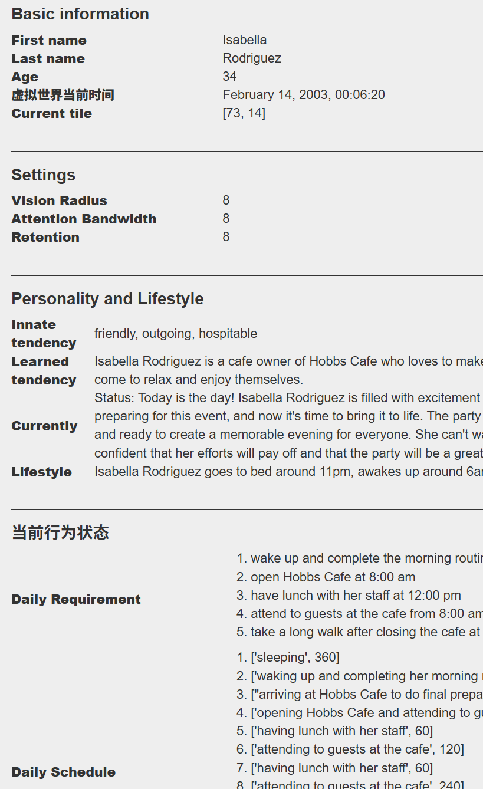
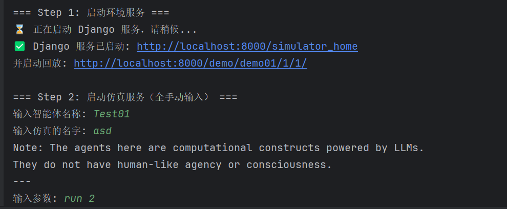
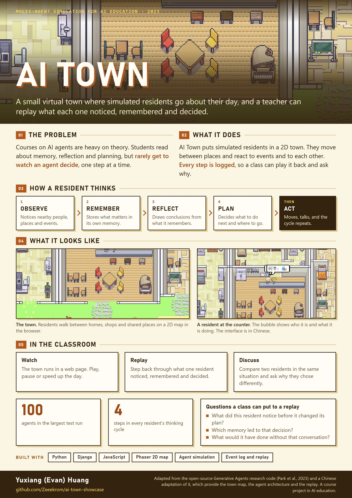

# AI 小镇

[English](README.md) | **中文**

一个用来讲解 AI 智能体行为的虚拟小镇。模拟居民在一张 2D 地图上过自己的一天，教师可以回放每个居民注意到了什么、记住了什么、做了什么决定。这是我在上海杉达学院的一门课程项目（2025 年 10 月至 12 月），在一个开源研究项目的基础上改造而成。

本仓库只做展示：截图、一段录屏、一张海报和这份说明，不包含源代码。系统基于什么、哪些部分是我做的，见[第三方内容](#第三方内容)。

## 目录

- [概览](#概览)
- [为什么做这个项目](#为什么做这个项目)
- [面向谁](#面向谁)
- [居民是怎么思考的](#居民是怎么思考的)
- [系统结构](#系统结构)
- [界面](#界面)
- [课堂上怎么用](#课堂上怎么用)
- [测试](#测试)
- [还没做完的部分](#还没做完的部分)
- [第三方内容](#第三方内容)
- [工具](#工具)
- [海报](#海报)
- [版权与联系](#版权与联系)

## 概览

| | |
|---|---|
| 是什么 | 一个用于课堂演示的多智能体仿真系统。虚拟小镇里的居民会观察、记忆、反思、计划和行动 |
| 基于 | 开源的 Generative Agents 研究代码，以及它的一个中文改版 |
| 我做的部分 | 把它改造成教学用的平台：整理代码让它能在课堂上读懂、一键启动脚本、课堂用法、规模测试和课程报告 |
| 技术栈 | Python 3.9、Django 2.2、浏览器里的 Phaser 2D 地图，状态和日志用 JSON 与 CSV 文件保存 |
| 测试规模 | 10、50、100 个智能体，最长 2000 步 |
| 背景 | 软件工程专业课程项目，上海杉达学院，2025 年 |
| 状态 | 已完成的课程项目，界面为中文 |

## 为什么做这个项目

AI 课程偏重算法和理论，学生能直接看到的东西很少。单个智能体的行为是怎么产生的、一群智能体之间怎么互相影响，光看图很难理解。让一个小镇在课堂上跑起来，观察、记忆、反思和计划的过程就能一步一步看见。

## 面向谁

| 使用者 | 需要什么 | 系统提供什么 |
|---|---|---|
| 教师 | 讲智能体时有一个现场例子 | 一个可以播放、暂停、加速的小镇，并且能单独回放任意一个居民 |
| 学生 | 弄清楚智能体为什么这样做 | 地图、每个居民当前的行为，以及显示其记忆和计划的页面 |

## 居民是怎么思考的

每个居民都走同样的五个阶段。观察到的内容连同时间和重要性权重一起保存。反思把一组记忆归纳成一般性的结论。计划同时参考两者，决定下一步做什么，而这个行动又会改变其他居民观察到的内容。

## 系统结构

| 层 | 作用 |
|---|---|
| 环境层 | 二维网格地图，包含宿舍、商店、公园和咖啡厅，负责路径规划和事件调度 |
| 智能体层 | 为每个居民运行五阶段循环 |
| 日志层 | 每一步记录每个居民的时间、位置和行为，以 JSON 和 CSV 保存 |
| 前端层 | 在浏览器里绘制地图和居民，并提供控制按钮 |

数据分成四类：环境、人物、日志和存储。每一类都以 JSON 保存、单独管理，所以新增一种事件或一个人物属性时不需要改动其他部分。

## 界面

| | |
|---|---|
|  |  |
| 小镇全貌：网格地图上的住所、公共建筑和空地 | 近景。居民在房间之间走动，并使用房间里的物品 |
|  |  |
| 每个居民头顶的气泡显示名字和正在做的事 | 仿真页面：上方是居民列表，中间是地图，下方是所选居民的状态 |
|  |  |
| 时间控制：继续、暂停和加速，并显示仿真中的日期和时间 | 单个居民的页面：基本信息、设置、性格和当天计划 |

启动脚本会启动 Web 服务，打开仿真页面和回放页面，然后启动仿真。

## 课堂上怎么用

1. **启动。** 一条命令启动全部服务并打开页面。
2. **运行。** 居民开始他们的一天。教师可以随时暂停，或者把平淡的部分加速带过。
3. **选一个居民。** 点击居民可以看到它的状态：正在做什么、记得什么、计划了什么。
4. **回放。** 运行结束后可以根据日志回放，整体回放或只看一个居民，教师边放边讲它为什么这样做。
5. **换场景。** 社交、购物、聚会等事件提供了可以对比的不同情境。

## 测试

数据来自课程报告。所有测试都在同一台笔记本上进行（Intel i7-12700H，16 GB 内存），环境为 Python 3.9、Django 2.2 和 Chrome。

| 智能体数量 | 步数 | CPU 占用 | 内存 | 帧率 | 日志 |
|---|---|---|---|---|---|
| 10 | 2000 | 25% | 0.6 GB | 60 fps | 正常生成 |
| 50 | 2000 | 45% | 1.2 GB | 58 fps | 稳定生成 |
| 100 | 2000 | 70% | 1.8 GB | 52 fps | 略有延迟，无异常 |

测试覆盖 10、50、100 个智能体和 500、1000、2000 步，检查的是稳定性和流畅度，没有评估智能体决策的质量。

## 还没做完的部分

- 小镇只有二维。
- 行为逻辑仍然依赖规则。
- 课程报告里没有测量学生是否因此学得更好。
- 界面只有中文。

## 第三方内容

这个项目是改造，不是从零写的。

- **Generative Agents。** 仿真框架、智能体架构（感知、记忆、反思、计划）、小镇地图和人物美术，以及带回放功能的浏览器前端，来自论文 [Generative Agents: Interactive Simulacra of Human Behavior](https://arxiv.org/abs/2304.03442)（Park 等，2023）随附的开源代码。
- **它的一个中文改版。** 我的起点是一个社区版本，它已经加上了中文界面和对本地语言模型的支持。

我自己做的部分：

- **让代码能在课堂上读懂。** 我改动了仿真核心和前端模板 185 个源文件中的 32 个。其中很大一部分是把规划、记忆、反思、感知、执行和路径规划模块的注释与文档字符串改写成中文，并整理了仿真主程序。
- **一键启动脚本。** 检查依赖，启动 Web 服务，打开仿真页面和回放页面，然后启动仿真。
- **教学部分。** 小镇在一节课里怎么用、系统结构图、上面的规模测试，以及课程报告。

## 工具

Python 3.9、Django 2.2、Phaser、JSON 与 CSV 文件、Chrome、PyCharm。

## 海报

一页纸的项目介绍（英文），2026 年 10 月制作。

## 版权与联系

截图中的小镇地图和人物美术归原项目作者所有。本说明、结构图和海报 © 2025-2026 黄钰祥（Yuxiang Huang），如需使用请先联系我。

联系方式：[LinkedIn](https://www.linkedin.com/in/evan-h-165976301/)
