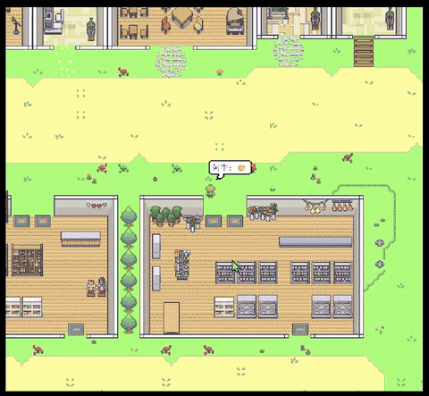
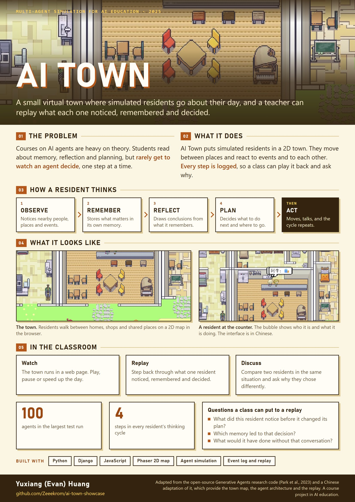
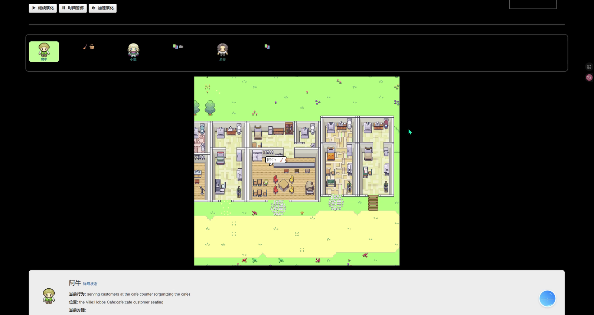
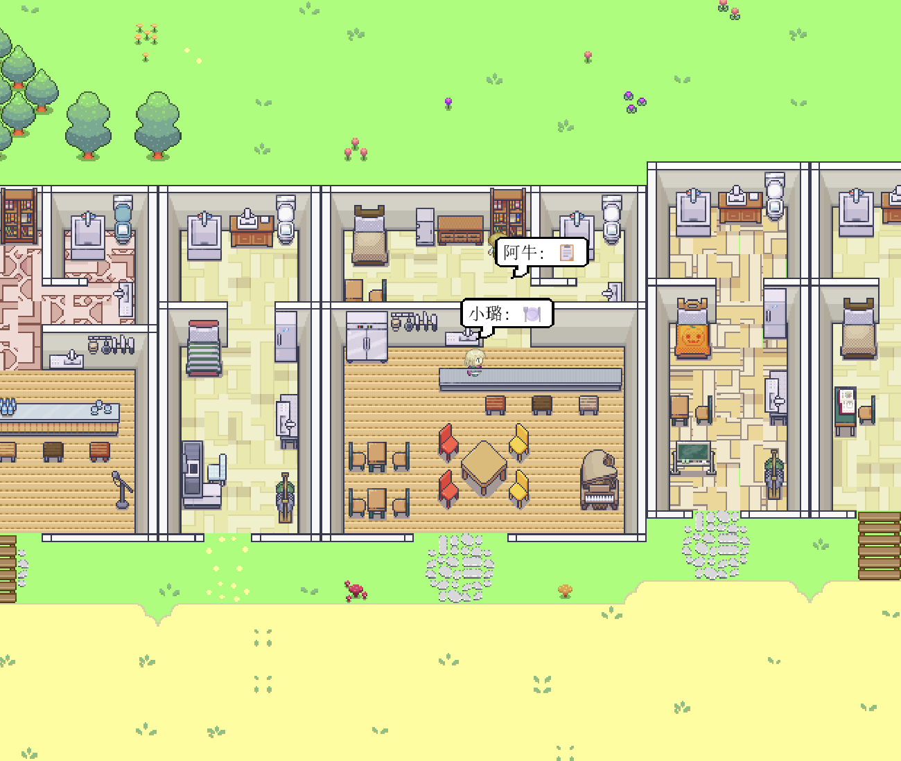
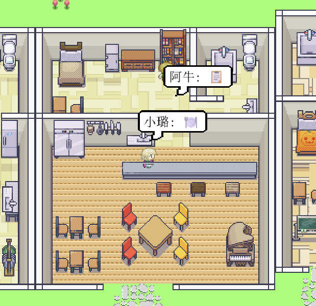
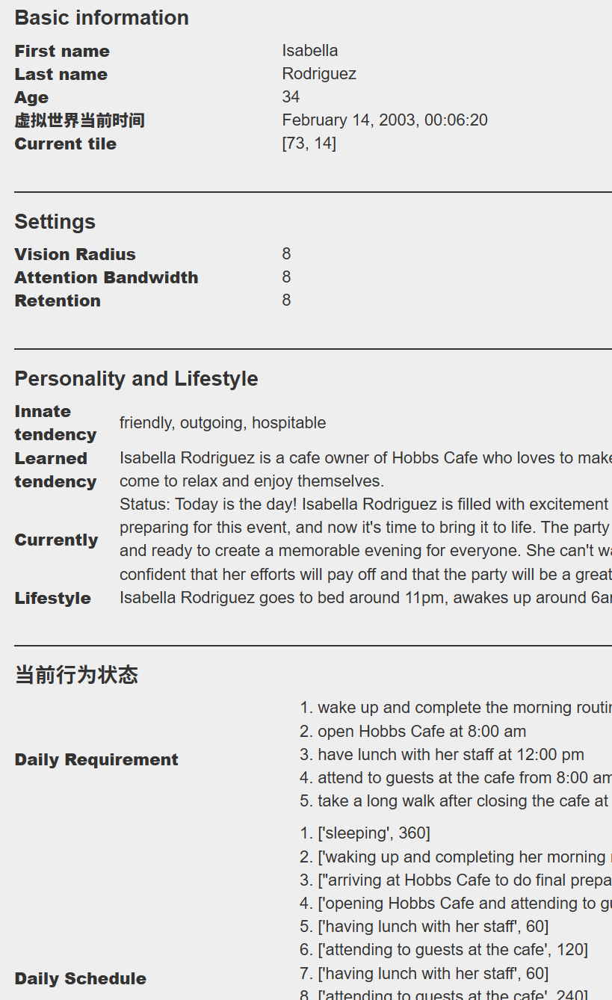
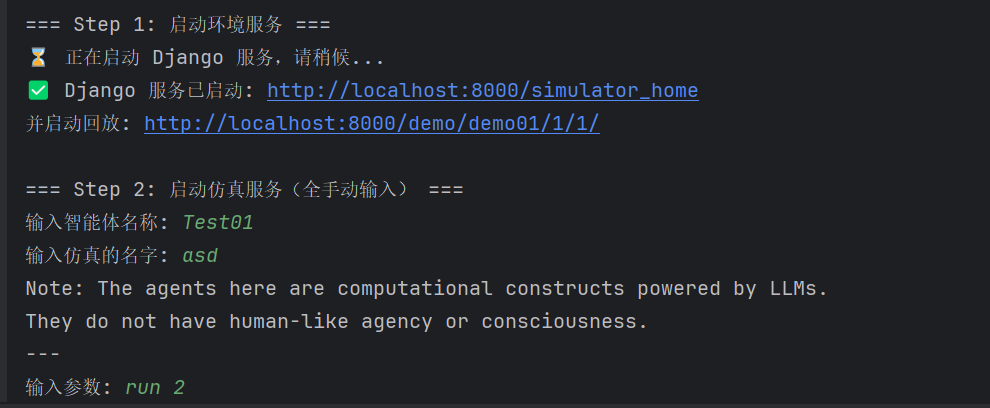

# AI 小镇

[English](README.md) · **简体中文**

AI 小镇（AI Town）是一个用来讲解 AI 智能体行为的小型虚拟小镇。模拟居民在浏览器里的一张 2D 地图上过自己的一天，在不同地点之间走动，对事件和彼此做出反应。教师可以暂停小镇、加速，并回放每个居民注意到了什么、记住了什么、做了什么决定。

每个居民都是一个 AI 智能体，走同样的循环：观察、记忆、反思、计划、行动。课堂上看的就是这个循环。每一步都有日志，所以一次运行结束后可以回放，全班可以追问某个居民为什么这样做。

这是我在上海杉达学院软件工程专业的一门课程项目（2025 年 10 月至 12 月）。它是改造，不是新的智能体设计。仿真框架、智能体架构、小镇地图和带回放功能的浏览器前端，来自开源的 Generative Agents 研究代码，经由它的一个中文改版。我做的是让它能在课堂上用起来。

本仓库只做展示：一段录屏、截图、一张海报和这份说明，不包含源代码。

<table>
<tr>
<td></td>
<td></td>
</tr>
<tr>
<td align="center"><a href="media/preview.gif">小镇运行的录屏</a></td>
<td align="center"><a href="media/poster.jpg">海报（英文），2026 年 10 月</a></td>
</tr>
</table>

**原始研究：** [Generative Agents: Interactive Simulacra of Human Behavior](https://arxiv.org/abs/2304.03442)（Park 等，2023）
——本项目改造的[开源代码](https://github.com/joonspk-research/generative_agents)就是随这篇论文发布的。
这份代码采用 Apache License 2.0 许可。

仿真页面。上方是时间控制和居民列表，中间是小镇地图，下方是所选居民当前在做什么、在哪里。界面是中文。小镇地图和人物美术来自原项目。

## 目录

- [一眼看懂](#一眼看懂)
- [要解决的问题](#要解决的问题)
- [给谁用](#给谁用)
- [一节课从头到尾](#一节课从头到尾)
- [居民是怎么思考的](#居民是怎么思考的)
- [界面](#界面)
- [现在已经做到的](#现在已经做到的)
- [设计原则](#设计原则)
- [怎么一步步做出来的](#怎么一步步做出来的)
- [技术栈](#技术栈)
- [验证证据](#验证证据)
- [还没做完的](#还没做完的)
- [这个项目说明了什么](#这个项目说明了什么)
- [版权与条款](#版权与条款)

## 一眼看懂

| | |
|---|---|
| 是什么 | 一个用于课堂演示的多智能体仿真系统。虚拟小镇里的居民会观察、记忆、反思、计划和行动，每一步都记日志，可以回放 |
| 给谁用 | 讲 AI 智能体时需要一个现场例子的教师，以及想弄清楚智能体为什么这样做的学生 |
| 要解决的问题 | AI 课程偏重算法和理论。光看图，很难理解单个智能体的行为是怎么产生的，一群智能体之间又怎么互相影响 |
| AI | 每个居民都是基于 Generative Agents 架构的智能体。我起步用的中文版本已经加上了对本地语言模型的支持 |
| 基于 | 开源的 Generative Agents 研究代码（Apache License 2.0），以及它的一个中文改版 |
| 我做的部分 | 把它改造成教学用的平台：整理代码让它能在课堂上读懂、一键启动脚本、课堂用法、规模测试和课程报告 |
| 技术栈 | Python 3.9、Django 2.2、浏览器里的 Phaser 2D 地图，状态和日志用 JSON 与 CSV 文件保存 |
| 证据 | 在一台笔记本上用 10、50、100 个智能体跑了最长 2000 步的规模测试，结果记在课程报告里 |
| 背景 | 软件工程专业课程项目，上海杉达学院，2025 年 10 月至 12 月 |
| 状态 | 已完成的课程项目，界面为中文 |

## 要解决的问题

AI 课程偏重算法和理论，学生能直接看到的东西很少。学生读到记忆、反思和计划，却很少能一步一步看着一个智能体做决定。一张图回答不了课堂上真正会问的问题：

- 这个居民改变计划之前，注意到了什么？
- 是哪一条记忆导致了这个决定？
- 如果没有那次对话，它会怎么做？
- 一群智能体之间是怎么互相影响的？

AI 小镇让一个小镇在课堂上跑起来，观察、记忆、反思和计划的过程都能看见，之后还能回放。

## 给谁用

| 使用者 | 需要什么 | AI 小镇提供什么 |
|---|---|---|
| 教师 | 讲智能体时有一个现场例子 | 一个可以播放、暂停、加速的小镇，并且能单独回放任意一个居民 |
| 学生 | 弄清楚智能体为什么这样做 | 地图、每个居民当前的行为，以及显示其记忆和计划的页面 |

这些角色描述的是课程报告里写的课堂用法。报告没有测量学生是否因此学得更好。

## 一节课从头到尾

1. **启动。** 一条命令检查依赖，启动 Web 服务，打开仿真页面和回放页面，然后启动仿真。
2. **运行。** 居民开始他们的一天。教师可以随时暂停，或者把平淡的部分加速带过。
3. **选一个居民。** 点击居民可以看到它的状态：正在做什么、记得什么、计划了什么。
4. **回放。** 运行结束后可以根据日志回放，整体回放或只看一个居民，教师边放边讲它为什么这样做。
5. **换场景。** 社交、购物、聚会等事件提供不同的情境。可以把处在同一情境里的两个居民放在一起比，让全班讨论它们为什么做了不同的选择。

## 居民是怎么思考的

每个居民都走同样的五个阶段。观察到的内容连同时间和重要性权重一起保存。反思把一组记忆归纳成一般性的结论。计划同时参考两者，决定下一步做什么，而这个行动又会改变其他居民观察到的内容。

这个循环来自 Generative Agents 的架构。课程这部分工作是把它展示出来：每个阶段的代码都加上了中文注释，界面让全班可以跟着一个居民走完整个循环。

## 界面

| | |
|---|---|
|  |  |
| **小镇全貌。** 网格地图上的住所、公共建筑和空地 | **近景。** 居民在房间之间走动，并使用房间里的物品 |
|  |  |
| **对话气泡。** 每个居民头顶的气泡显示名字和正在做的事 | **时间控制。** 继续、暂停和加速，并显示仿真中的日期和时间 |
|  |  |
| **单个居民的页面。** 基本信息、设置、性格和当天计划 | **启动脚本。** 启动 Web 服务，打开仿真页面和回放页面，然后启动仿真 |

仿真页面见本页开头。小镇地图和人物美术来自原项目，原项目把它们署名给各自的美术作者。

## 现在已经做到的

| 能力 | 做什么 |
|---|---|
| 小镇地图 | 二维网格地图，包含宿舍、商店、公园和咖啡厅。路径规划让居民在各个地点之间移动 |
| 居民循环 | 每个居民都会观察、记忆、反思、计划和行动。记忆按时间顺序保存，带重要性权重 |
| 事件 | 环境层负责调度事件。社交、购物、聚会等事件提供可以对比的不同情境 |
| 每步日志 | 每一步记录每个居民的时间、位置和行为，以 JSON 和 CSV 保存 |
| 浏览器地图 | Phaser 绘制地图和居民。每个居民头顶的气泡显示名字和当前行为 |
| 时间控制 | 继续、暂停和加速，并显示仿真中的日期和时间 |
| 居民页面 | 基本信息、设置、性格、记忆和当天计划 |
| 回放 | 运行结束后根据日志回放，可以整体回放，也可以只看一个居民 |
| 分开的数据类别 | 环境、人物、日志和存储四类数据各自以 JSON 保存、单独管理，所以新增一种事件或一个人物属性时不需要改动其他部分 |
| 启动脚本 | 一条命令检查依赖，启动 Web 服务，打开仿真页面和回放页面，然后启动仿真 |
| 适合课堂阅读的代码 | 规划、记忆、反思、感知、执行和路径规划模块里的注释与文档字符串都改成了中文 |
| 规模 | 在一台笔记本上跑 100 个智能体、2000 步 |

地图、智能体循环和带回放功能的浏览器前端来自开源代码。中文界面和本地语言模型支持来自社区的中文改版。启动脚本和代码整理是为这门课加的，见[怎么一步步做出来的](#怎么一步步做出来的)。

## 设计原则

- **让思考过程看得见。** 全班应该能一步一步看着观察、记忆、反思和计划发生，而不只是读到它们。
- **每一步都记日志。** 每一步都记下每个居民的时间、位置和行为，所以任何一次运行事后都能解释。
- **跟着一个居民看。** 任何一个居民都可以在运行中打开，或者单独回放，全班可以顺着一条决策线看下去。
- **时间由教师控制。** 小镇可以随时暂停，平淡的部分可以加速。
- **数据类别分开放。** 新增一种事件或一个人物属性，不应该牵动其他所有部分。
- **代码要让课堂读得懂。** 注释和文档字符串用中文，也就是这门课用的语言。
- **只说测过的事。** 规模测试检查的是稳定性和流畅度，报告里也只这样说。

## 怎么一步步做出来的

AI 小镇是改造，不是从零写的。

**起点**

- **Generative Agents。** 仿真框架、智能体架构（感知、记忆、反思、计划）、小镇地图和人物美术，以及带回放功能的浏览器前端，来自论文 [Generative Agents: Interactive Simulacra of Human Behavior](https://arxiv.org/abs/2304.03442)（Park 等，2023）随附的开源代码。
- **它的一个中文改版。** 我的起点是一个社区版本，它已经加上了中文界面和对本地语言模型的支持。

**我为这门课加的部分**

- **让代码能在课堂上读懂。** 我改动了仿真核心和前端模板 185 个源文件中的 32 个。其中很大一部分是把规划、记忆、反思、感知、执行和路径规划模块的注释与文档字符串改写成中文，并整理了仿真主程序。
- **一键启动脚本。** 检查依赖，启动 Web 服务，打开仿真页面和回放页面，然后启动仿真。
- **教学部分。** 小镇在一节课里怎么用、系统结构图、规模测试，以及课程报告。

| 日期 | 做了什么 |
|---|---|
| 2025 年 10 月至 12 月 | 上海杉达学院软件工程专业课程项目：改造代码、启动脚本、规模测试和课程报告 |
| 2026 年 10 月 11 日 | 发布这个展示仓库：说明、截图、一段录屏，以及当月制作的单页海报 |

## 技术栈

- Python 3.9
- Django 2.2，用作 Web 服务
- Phaser（JavaScript），用于浏览器里的 2D 地图
- JSON 与 CSV 文件，保存状态和日志
- Chrome 运行页面，PyCharm 用于开发

| 层 | 作用 |
|---|---|
| 环境层 | 二维网格地图，包含宿舍、商店、公园和咖啡厅，负责路径规划和事件调度 |
| 智能体层 | 为每个居民运行五阶段循环 |
| 日志层 | 每一步记录每个居民的时间、位置和行为，以 JSON 和 CSV 保存 |
| 前端层 | 在浏览器里绘制地图和居民，并提供控制按钮 |

## 验证证据

有记录的测试是课程报告里的规模测试。所有测试都在同一台笔记本上进行（Intel i7-12700H，16 GB 内存），环境为 Python 3.9、Django 2.2 和 Chrome。

| 智能体数量 | 步数 | CPU 占用 | 内存 | 帧率 | 日志 |
|---|---|---|---|---|---|
| 10 | 2000 | 25% | 0.6 GB | 60 fps | 正常生成 |
| 50 | 2000 | 45% | 1.2 GB | 58 fps | 稳定生成 |
| 100 | 2000 | 70% | 1.8 GB | 52 fps | 略有延迟，无异常 |

测试覆盖 10、50、100 个智能体和 500、1000、2000 步；表里列的是 2000 步的结果。测试检查的是稳定性和流畅度，没有评估智能体决策的质量。

## 还没做完的

- 小镇只有二维。
- 行为逻辑仍然依赖规则。
- 课程报告里没有测量学生是否因此学得更好。
- 界面只有中文。
- 规模测试只在一台笔记本上做过，说明不了智能体决策的质量。

## 这个项目说明了什么

- 每一步都记日志，一次运行事后才能解释清楚。回放之所以能用，是因为日志在那里。
- 让研究代码能用于教学，主要是让它读得懂。改动里很大一部分是注释和文档字符串，而不是新功能。
- 在一台笔记本上，小镇跑到 100 个智能体仍然流畅（52 fps，CPU 占用 70%）。跑得流畅不等于决策得好，而后者没有测过。
- 说清楚哪些部分是借来的，才能看清课程这部分工作到底做了什么。

## 版权与条款

© 2025-2026 AI Town。保留所有权利，见 [LICENSE](LICENSE)。本仓库里的说明、结构图、海报和录屏截图，以及项目自己的代码改动和设计，未经书面许可不得转载、复制或改编。欢迎分享链接。开源部分保留各自的许可：Generative Agents 代码采用 Apache License 2.0，截图、录屏和海报里的小镇地图和人物美术归原作者所有。如需许可，请通过 [LinkedIn](https://www.linkedin.com/in/evan-h-165976301/) 联系我。
